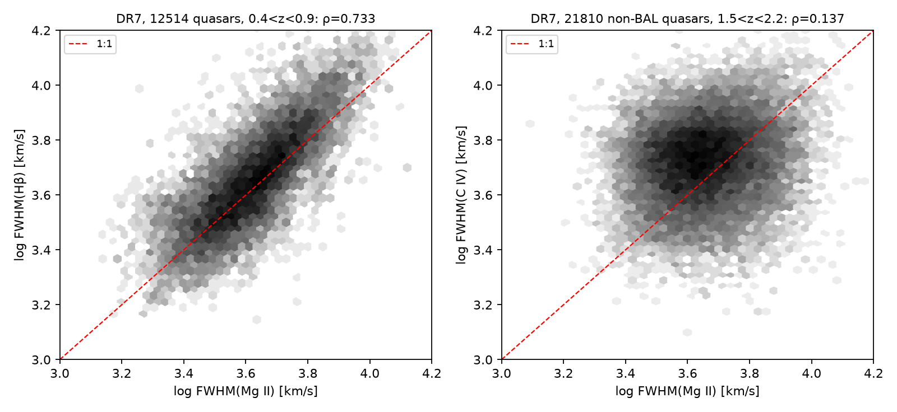
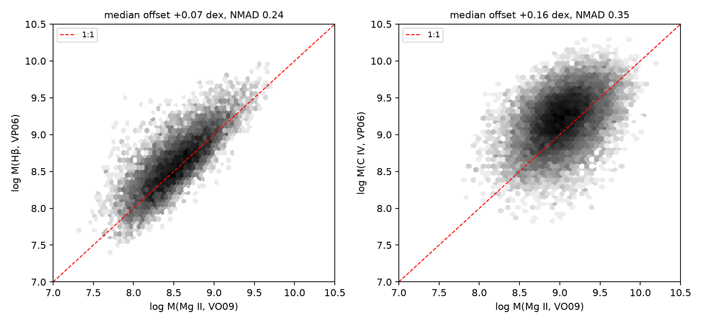
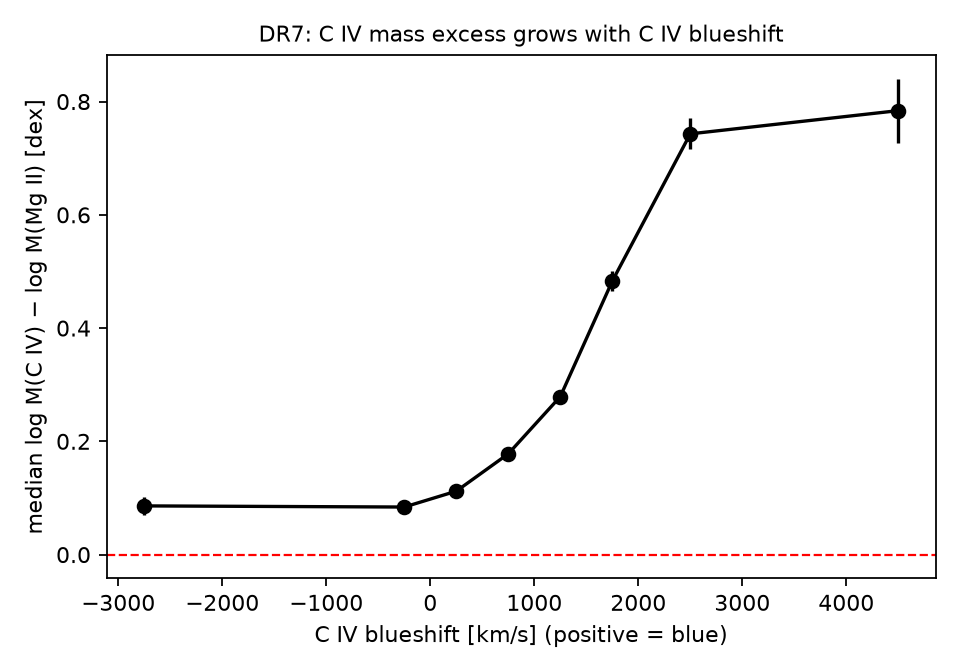
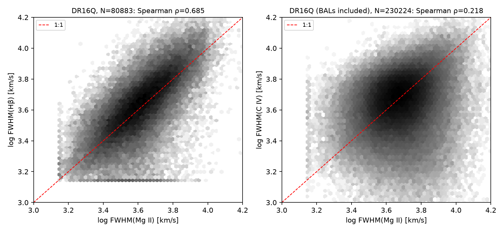
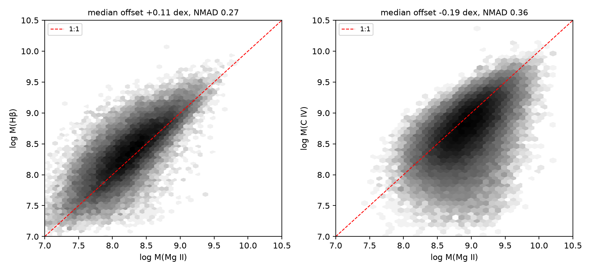
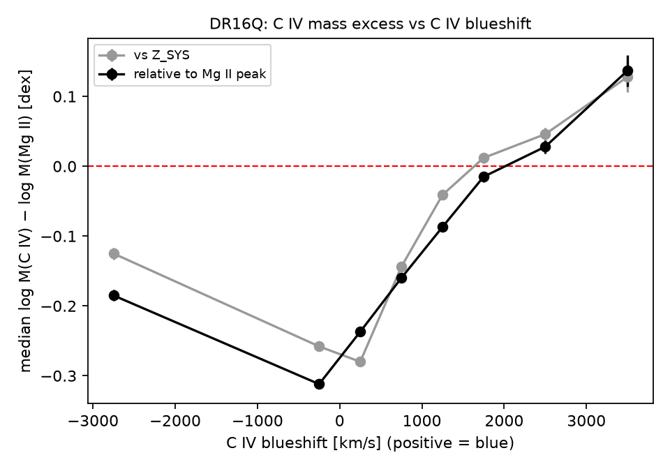

# Abstract

Black-hole masses of z > 6 quasars and of the JWST "Little Red Dots" (LRDs) are large enough to strain seeding and growth models. The C IV λ1549 line, the only strong broad line in the rest-frame ultraviolet, is a notoriously poor virial tracer, and it has been suggested that C IV-based masses inflate the early black-hole mass scale. We test this on the two largest homogeneous catalogs of single-epoch line measurements: the SDSS DR7 catalog of Shen et al. (2011; 105,783 quasars) and the SDSS DR16Q catalog of Wu & Shen (2022; 750,414 quasars). Because Hβ and C IV are a factor 3.14 apart in wavelength, no SDSS or BOSS spectrum contains both lines; we therefore compare Hβ with Mg II at 0.35 < z < 0.89 and Mg II with C IV at 1.5 < z < 2.25. In DR7, FWHM(Hβ) and FWHM(Mg II) correlate strongly (12,514 quasars, Spearman ρ = 0.73; mass offset +0.01 dex, scatter 0.25 dex), while FWHM(C IV) correlates only weakly with FWHM(Mg II) (21,810 non-BAL quasars, ρ = 0.14). Against the catalog's fiducial Mg II calibration the median C IV mass offset is −0.02 dex with a 0.37 dex scatter; against the Vestergaard & Osmer (2009) calibration it is +0.16 dex. The bias is not a constant: the median excess of the C IV mass rises monotonically with the C IV blueshift relative to Mg II, from −0.15 to −0.25 dex at zero blueshift to +0.3 dex (DR7) at 1,500–2,000 km s⁻¹ and +0.4–0.6 dex (DR7) above 2,000 km s⁻¹, reproducing Coatman et al. (2017) on samples a hundred times larger. DR16Q (230,224 Mg II–C IV pairs, 66,357 with both masses) shows the same trend with ρ = 0.19–0.37 and a 0.45–0.6 dex amplitude; its lower zero point traces to C IV widths that its fitting code returns 20 per cent narrower, relative to Mg II, than the DR7 fits. Only 5–13 per cent of SDSS quasars have blueshifts above 1,500 km s⁻¹, so the population-wide bias is small, but z > 6 quasars have median C IV–Mg II blueshifts near 1,850 km s⁻¹, so a C IV mass for a typical z > 6 quasar would be high by ≈ 0.1–0.3 dex against the fiducial Mg II calibration and ≈ 0.3–0.5 dex against the Vestergaard & Osmer (2009) one. This does not, however, explain the "overmassive" early black holes: the published z > 6 quasar masses rest on Mg II, not C IV, and JWST Balmer-line masses agree with them to within the 0.4–0.5 dex systematic scatter in every case we could check (J0100+2802, J1120+0641, J1148+5251, J0218+0007). The LRD masses are Balmer-line masses from JWST itself, and C IV is usually not even detected in LRDs. We also show that the X-ray photon-index–Eddington-ratio relation cannot replace line widths as a mass estimator: its scatter in λ_Edd is 0.35–0.6 dex, it shows no correlation when C IV masses are used, and LRDs are X-ray weak by 1–2 dex. The C IV problem is real and quantifiable, but it is not the origin of the JWST mass tension.

# 1. Introduction

Quasars with black-hole masses above 10⁹ M☉ exist at z > 7 (Mortlock et al. 2011; Bañados et al. 2018; Yang et al. 2020; Wang et al. 2021), and JWST has added a population of faint broad-line active galactic nuclei (AGN) at z ≈ 4–9, many of them compact and red ("Little Red Dots"; Matthee et al. 2024; Greene et al. 2024; Kocevski et al. 2024), whose black holes appear overmassive relative to their host galaxies (Pacucci et al. 2023; Maiolino et al. 2024). Both results depend on single-epoch virial masses, M_BH ∝ FWHM² L^α, which assume that the broad-line gas is gravitationally bound and that the line width measures its virial velocity.

That assumption is well tested for Hβ, the line calibrated directly by reverberation mapping, and it transfers well to Mg II λ2798, which arises in the same low-ionization gas (Shen et al. 2008; Wang et al. 2009; Shen & Liu 2012). It fails, at least in part, for C IV λ1549. C IV is systematically blueshifted relative to the systemic redshift (Gaskell 1982; Richards et al. 2011), its width correlates poorly with that of the Balmer lines (Baskin & Laor 2005; Shen & Liu 2012), part of its profile does not reverberate (Denney 2012), and the resulting virial masses are biased in proportion to the blueshift (Coatman et al. 2016, 2017), with corrections proposed from the line shape (Denney 2012), from the Si IV + O IV]/C IV peak ratio (Runnoe et al. 2013), from the blueshift (Coatman et al. 2017) and from the line dispersion rather than the FWHM (Park et al. 2017).

Before JWST, the Balmer lines of z > 6 quasars were inaccessible from the ground, and Mg II was the estimator of choice (Fan, Bañados & Simcoe 2023, §4.1). Now that JWST NIRSpec, NIRCam/WFSS and MIRI place Hβ, Hα and even the Paschen lines within reach at z > 6 (Eilers et al. 2023; Yang et al. 2023; Bosman et al. 2024; Marshall et al. 2025), it is natural to ask whether the rest-frame ultraviolet masses were biased and whether that bias contributes to the apparent abundance of massive early black holes. This paper does two things. First, it measures the C IV bias on the largest available samples, as a function of blueshift and luminosity, with every number reproducible from public catalogs (§§2–4). Second, it asks whether that bias has any bearing on the JWST results, by checking, object by object, which line the published z > 6 and LRD masses actually rest on (§5), and whether an X-ray estimator could sidestep the problem (§6).

An earlier draft of this work claimed a uniform C IV overestimate of 0.41 dex, a complete absence of correlation between C IV and Mg II, and that the z > 6 and LRD masses were C IV-based and therefore a "mirage". None of these claims survives contact with the catalogs or the literature; the audit is in the accompanying `REVIEW.md`.

# 2. Data

## 2.1 Catalogs

We use two public catalogs of spectral measurements, not our own fits.

*SDSS DR7.* Shen et al. (2011) measured continuum and line properties for the 105,783 quasars of Schneider et al. (2010). Hβ is fitted for z ≤ 0.89, Mg II for 0.35 ≤ z ≤ 2.25 and C IV for 1.5 ≤ z ≤ 4.95. Line widths are FWHMs of multi-Gaussian broad components after subtraction of a power-law continuum and an iron template. The catalog gives virial masses with the Vestergaard & Peterson (2006, VP06) calibrations for Hβ and C IV, the Vestergaard & Osmer (2009, VO09) calibration for Mg II, and Shen et al.'s own Mg II calibration (S10), which is the catalog's fiducial Mg II mass and is built to have zero mean offset from the VP06 Hβ masses. The catalog also gives the velocity shift of the C IV peak relative to the systemic redshift (positive = blueshift) and a BAL flag. File: `dr7_bh_Nov19_2013.fits.gz`.

*SDSS DR16Q.* Wu & Shen (2022) fitted the 750,414 broad-line quasars of the DR16 quasar catalog (Lyke et al. 2020) with the same code (PyQSOFit) and the same fiducial mass recipes as Shen et al. (2011). Line properties are stored as arrays whose fifth element is the FWHM. Systemic redshifts (`Z_SYS`) are given separately from the fitting redshift (`Z_FIT`). This catalog carries no BAL flag, so BAL quasars remain in the DR16Q sample; the DR7 sample, from which BALs are removed, shows the effect of that choice. File: `dr16q_prop_May01_2024.fits.gz`.

## 2.2 Why no object has all three lines

Hβ 4861 Å and C IV 1549 Å differ in wavelength by a factor 3.14. The SDSS spectrograph covers 3800–9200 Å (ratio 2.42) and the BOSS spectrograph 3600–10400 Å (ratio 2.89; Smee et al. 2013). No single SDSS or BOSS spectrum can contain both lines, and in both catalogs the Hβ (z ≲ 0.9–1.1) and C IV (z ≳ 1.5) fitting windows do not overlap. All comparisons of Hβ with C IV in the literature use near-infrared spectroscopy of small samples (e.g. Shen & Liu 2012, 60 objects; Coatman et al. 2017, 230 objects). In SDSS one can only compare Hβ with Mg II in one redshift slice and Mg II with C IV in another, and that is what we do. Any claim of a three-line "same-object" SDSS sample is impossible.

## 2.3 Quality cuts and samples

For each line we require a finite FWHM ≥ 1000 km s⁻¹, a finite positive error, and FWHM/σ_FWHM ≥ 3. For C IV in DR7 we additionally require `BAL_FLAG = 0`. Table 1 gives the resulting samples.

**Table 1.** Samples. Redshift ranges are the 1st–99th percentiles of each sample.

| sample | DR7 N | DR7 z | DR16Q N | DR16Q z |
|---|---|---|---|---|
| Hβ | 17,687 | 0.16–0.88 | 96,965 | 0.19–0.99 |
| Mg II | 72,305 | 0.40–2.19 | 533,036 | 0.44–2.47 |
| C IV | 39,139 (non-BAL) | 1.51–4.08 | 366,757 (BALs included) | 1.51–3.78 |
| Hβ + Mg II | 12,514 | 0.37–0.88 | 80,883 | 0.37–0.99 |
| Mg II + C IV | 21,810 | 1.51–2.23 | 230,224 | 1.51–2.48 |
| Hβ + C IV | 0 | — | 0 | — |

In DR16Q we further restrict each line to the redshift range in which the line and its continuum window lie inside the BOSS bandpass (Hβ z ≤ 1.0, Mg II 0.35–2.5, C IV 1.5–5.0); the catalog carries edge fits outside these ranges that are not usable. Wu & Shen (2022) compute a virial mass only where the corresponding continuum luminosity is measured, so the DR16Q mass comparisons use 47,518 (Hβ–Mg II) and 66,357 (C IV–Mg II) objects.

# 3. Method

We compare line widths with the Spearman rank correlation of log FWHM, which is insensitive to the heavy tails of FWHM distributions, and we also report the Pearson coefficient of the linear FWHMs for comparison with older work. Virial masses are taken from the catalogs. In DR7 we compare the VP06 Hβ mass with both Mg II calibrations (S10, VO09) and the VP06 C IV mass with both; in DR16Q only the fiducial (S10-type) Mg II mass is available. Mass differences are summarised by the median and by the normalised median absolute deviation (NMAD = 1.4826 × MAD), which is robust to outliers; we also give the 16th and 84th percentiles and the fraction of objects whose C IV mass exceeds, or falls below, the Mg II mass by more than 0.5 dex.

We use two C IV blueshifts. Relative to the systemic redshift: in DR7 the catalog's `VOFF_CIV_PEAK` (positive = blueshift, as the catalog defines it and as the known mean C IV blueshift confirms; Richards et al. 2011); in DR16Q the fitted peak wavelength λ_peak (given in the `Z_FIT` frame) transformed to the `Z_SYS` frame, v = c (1549.06 − λ_peak (1 + z_fit)/(1 + z_sys)) / 1549.06. Relative to Mg II: `VOFF_CIV_PEAK − VOFF_BROAD_MGII` in DR7, and c [(1549.06 − λ_CIV)/1549.06 − (2798.75 − λ_MgII)/2798.75] from the two peak wavelengths in DR16Q. The second definition is the one used for z > 6 quasars and is independent of any redshift estimate, so it is the one we tabulate.

All scripts are in `code/`, all numbers in `results/*.json`; nothing in this paper is typed by hand.

# 4. Results

## 4.1 Hβ and Mg II agree

**Table 2.** Hβ versus Mg II (DR7, 12,514 quasars, 0.35 < z < 0.89).

| quantity | DR7 | DR16Q |
|---|---|---|
| Spearman ρ, log FWHM | 0.733 | 0.685 (0.761 at S/N ≥ 10, N = 19,976) |
| Pearson r, linear FWHM | 0.691 | 0.627 |
| OLS slope, log FWHM(Hβ) on log FWHM(Mg II) | 0.856 | 0.819 |
| scatter about OLS line | 0.137 dex | 0.157 dex |
| median FWHM(Hβ)/FWHM(Mg II) | 1.08 | 1.05 |
| median log M(Hβ) − log M(Mg II), fiducial Mg II | +0.011 dex (N = 12,484) | +0.106 dex (N = 47,518) |
| NMAD of the mass difference | 0.247 dex | 0.271 dex |
| Spearman ρ of the two masses | 0.748 | 0.735 |

The two widths track each other with a 0.14–0.16 dex scatter (Fig. 1 and 4, left), the Hβ line being on average 5–8 per cent broader than Mg II, consistent with Wang et al. (2009) and Shen et al. (2008; 0.11 dex). In DR16Q the correlation strengthens from ρ = 0.69 to 0.76 when only spectra with median S/N ≥ 10 are kept, i.e. the DR7 value is recovered at DR7-like data quality; the remaining difference is measurement noise, not physics. The two masses agree in the median to 0.01 dex in DR7 against the fiducial Mg II calibration (+0.075 dex against VO09) with a 0.25 dex object-to-object scatter (Fig. 2, left). In DR16Q the Hβ masses are higher by +0.11 dex; the fiducial Mg II calibration was built to have zero offset on DR7, and the fainter BOSS quasars carry more host-galaxy light at 5100 Å. Correcting L₅₁₀₀ with the catalog's host fraction (`FHOST_5100`; M ∝ L^0.5, so Δlog M = 0.5 log(1 − f_host)) brings the DR16Q offset down to +0.045 dex. The ordinary least-squares slope of 0.82–0.86 is below unity because both variables carry comparable measurement scatter (regression dilution); the DR7 bisector slope is 1.18, and the symmetric statistics (ρ, NMAD) are the ones to quote. A slope well below unity is therefore not evidence against Mg II as a virial tracer.

## 4.2 C IV and Mg II barely correlate

**Table 3.** C IV versus Mg II (DR7, 21,810 non-BAL quasars, 1.5 < z < 2.25).

| quantity | DR7 | DR16Q |
|---|---|---|
| Spearman ρ, log FWHM | 0.137 (p ≈ 10⁻⁹²) | 0.218 (0.225 at S/N ≥ 10, N = 35,121) |
| Pearson r, linear FWHM | 0.165 | 0.221 |
| OLS slope, log FWHM(C IV) on log FWHM(Mg II) | 0.145 | 0.240 |
| median FWHM(C IV)/FWHM(Mg II) | 1.17 | 0.96 |
| median log M(C IV) − log M(Mg II), fiducial Mg II | −0.020 dex (N = 21,799) | −0.191 dex (N = 66,357) |
| same, VO09 Mg II | +0.163 dex (N = 21,323) | — |
| NMAD of the mass difference | 0.367 dex (fiducial); 0.348 (VO09) | 0.360 dex |
| 16th–84th percentile of the difference (fiducial) | −0.42 to +0.33 dex | −0.62 to +0.14 dex |
| fraction with M(C IV) > M(Mg II) by > 0.5 dex | 7.2 % (fiducial); 16.4 % (VO09) | 1.6 % |
| fraction with M(C IV) < M(Mg II) by > 0.5 dex | 12.0 % (fiducial); 4.8 % (VO09) | 22.4 % |
| Spearman ρ of the two masses | 0.355 | 0.508 |

The correlation is weak but highly significant in both catalogs (Fig. 1 and 4, right; ρ = 0.14 in DR7, 0.22 in DR16Q, unchanged at S/N ≥ 10); it is not absent, and the density ridge runs along the 1:1 line. The two masses correlate at ρ = 0.36–0.51 only, with a 0.36–0.37 dex scatter that matches the 0.34 dex of Shen et al. (2008) and the 0.40 dex "before correction" of Coatman et al. (2017). Whether C IV masses are on average *too high* depends entirely on the Mg II zero point and on the fitting procedure one compares with: −0.02 dex against the DR7 fiducial calibration, +0.16 dex against VO09, −0.19 dex in DR16Q (see §4.3 for why). There is no sample-wide 0.4 dex offset in either direction. At fixed Mg II mass the C IV mass is spread over ±0.3 dex (16th–84th percentiles): a DR7 quasar with log M(Mg II) in 9.0–9.5 has log M(C IV) between 8.96 and 9.58, and between 8.54 and 9.88 at the 2.5th–97.5th percentiles; in DR16Q the same bin gives 8.45–9.24.

## 4.3 The bias is a function of C IV blueshift and luminosity

We measure the blueshift of the C IV peak relative to the Mg II peak of the same object. This is the quantity measured for z > 6 quasars (Schindler et al. 2020) and it needs no systemic redshift; in DR7 it is `VOFF_CIV_PEAK − VOFF_BROAD_MGII`, in DR16Q it follows from the two fitted peak wavelengths. (Blueshifts relative to the catalog systemic redshift give the same picture with a smaller amplitude, because the systemic redshifts themselves lean on the UV lines; both versions are in `results/`.)

**Table 4.** Median log M(C IV) − log M(Mg II, fiducial calibration) in bins of C IV blueshift relative to Mg II (positive = C IV bluer). DR7 non-BAL; DR16Q BALs included. NMAD per bin is 0.29–0.52 dex in DR7 and 0.31–0.44 dex in DR16Q.

| blueshift [km s⁻¹] | DR7 N | DR7 median Δ | DR16Q N | DR16Q median Δ |
|---|---|---|---|---|
| −5000 to −500 | 1,028 | −0.40 | 2,897 | −0.19 |
| −500 to 0 | 2,250 | −0.25 | 10,580 | −0.31 |
| 0 to 500 | 5,511 | −0.15 | 21,664 | −0.24 |
| 500 to 1000 | 6,375 | −0.01 | 20,982 | −0.16 |
| 1000 to 1500 | 3,802 | +0.12 | 7,000 | −0.09 |
| 1500 to 2000 | 1,642 | +0.26 | 1,916 | −0.02 |
| 2000 to 3000 | 895 | +0.44 | 1,083 | +0.03 |
| > 3000 | 262 | +0.63 | 229 | +0.14 |
| Spearman ρ (blueshift, Δ) | 21,773 | 0.45 | 66,357 | 0.19 |
| median blueshift | | 654 km s⁻¹ | | 458 km s⁻¹ |
| fraction > 1,000 / 1,500 / 2,000 km s⁻¹ | | 30 / 13 / 5 % | | 15 / 5 / 2 % |

In DR7 the offset rises monotonically by ≈ 1 dex across the blueshift range (Fig. 3). At zero or negative blueshift the C IV mass is *lower* than the Mg II mass, as Coatman et al. (2016) found for their low-blueshift subset; above 2,000 km s⁻¹ it is higher by a factor 3–4, as Coatman et al. (2017) found at 3,000 km s⁻¹. Using the VO09 Mg II calibration instead shifts every DR7 entry up by ≈ 0.2 dex (the VO09–S10 zero-point difference) without changing the shape: the *mean* C IV bias is a statement about zero points, the *trend* is physics.

DR16Q shows the same monotonic trend with the same sign but a smaller amplitude (≈ 0.45 dex across the range) and a lower zero point (−0.19 dex overall). Both differences have identifiable causes. (i) *Noise in the blueshift.* BOSS spectra are fainter and noisier than the DR7 quasars; a noisy abscissa flattens any binned trend. Restricting DR16Q to a median spectral S/N ≥ 10 raises the Spearman correlation between blueshift and offset from 0.19 to 0.33 and the amplitude to ≈ 0.6 dex (−0.37 → +0.21). (ii) *Luminosity.* Restricting to log λL₁₃₅₀ ≥ 46, which matches the DR7 sample, gives ρ = 0.36 and a run from −0.32 to +0.23 dex (N = 6,090; +0.07 dex at 1,500–2,000 km s⁻¹ and +0.14 dex at 2,000–3,000 km s⁻¹), and raises the overall median from −0.19 to −0.09 dex. (iii) *The C IV width itself.* The median FWHM(C IV)/FWHM(Mg II) is 1.17 in DR7 but 0.96 in DR16Q, i.e. the PyQSOFit decomposition of Wu & Shen (2022) returns C IV widths ≈ 20 per cent narrower, relative to Mg II, than the Shen et al. (2011) fits; since M ∝ FWHM² this alone lowers the DR16Q C IV masses by 0.17 dex and accounts for the remaining zero-point difference. The inclusion of BAL quasars, whose absorbed C IV profiles are measured narrower, works in the same direction. The lesson is the same as for the calibration zero points: the mean C IV–Mg II offset is set by measurement conventions at the 0.2 dex level, whereas the monotonic growth of the offset with blueshift is present in every subsample.

The population impact is modest because large blueshifts are rare in a flux-limited optical survey: 13 per cent of DR7 and 5 per cent of DR16Q quasars exceed 1,500 km s⁻¹. The offset grows with luminosity in both catalogs (DR7, VO09: from +0.02 dex at log λL₁₃₅₀ = 44.5–45.5 to +0.29 dex at 46.5–47.5; DR16Q, fiducial: from −0.23 to −0.06 dex over 44.5–47.0), as the median blueshift rises from ≈ 350–400 to ≈ 570–990 km s⁻¹. The most luminous quasars, which are the ones found at z > 6, sit at the biased end.

## 4.4 Width distributions with redshift: selection, not evolution

Median FWHMs are nearly constant with redshift within each line's window. DR7: Hβ 4,100–4,500 km s⁻¹ (z = 0–1), Mg II 4,150–4,970 km s⁻¹ (z = 0.3–2.5), C IV 5,200–5,500 km s⁻¹ (z = 1.5–5). DR16Q: Hβ 3,670–4,300 km s⁻¹, Mg II 3,930–4,930 km s⁻¹, C IV 4,230–4,920 km s⁻¹ (the DR16Q values are lower because BOSS reaches fainter, less massive quasars). The slow rise with redshift in Mg II follows the flux limit: at higher z only the most luminous, and so most massive, quasars enter the sample. The FWHM(Mg II) distribution at 1 < z < 2 (500 km s⁻¹ bins; N ≈ 47,000 in DR7, ≈ 305,000 in DR16Q) has a single maximum at 4,000–4,500 km s⁻¹ in both catalogs and declines monotonically; there is no second peak. A plot of log M_BH against z shows the same flux-limit envelope and should not be read as black-hole growth.

# 5. Does the C IV bias explain the JWST "overmassive" black holes?

## 5.1 Luminous z > 6 quasars

The ground-based masses of z > 6 quasars are Mg II masses from near-infrared spectroscopy. Fan, Bañados & Simcoe (2023, §4.1) review "only … results based on Mg II measurements, which are thought to be the most reliable until Hβ-derived masses are possible"; Shen et al. (2019), Mazzucchelli et al. (2017) and Farina et al. (2022) all adopt Mg II as fiducial and use C IV only when Mg II is unavailable. The C IV bias therefore cannot have inflated the published z > 6 mass scale, because that scale does not rest on C IV.

It would have, had C IV been used. The C IV–Mg II blueshift of z > 6 quasars is large: a median of 1,848 km s⁻¹ in the 38 X-SHOOTER quasars of Schindler et al. (2020), against ≈ 800 km s⁻¹ in luminosity-matched low-redshift quasars, and a factor ≈ 2.5 above the z < 6 mean in the 394-quasar compilation of Meyer, Bosman & Ellis (2019). Reading Table 4 at 1,500–2,000 km s⁻¹ gives an expected C IV excess of +0.26 dex (DR7) or +0.07 dex (DR16Q, log λL₁₃₅₀ ≥ 46) against the fiducial Mg II calibration, +0.3 to +0.5 dex against VO09, with a 0.3–0.35 dex object-to-object scatter on top. Uncorrected C IV masses of z > 6 quasars should be treated as upper limits; blueshift-corrected ones (Coatman et al. 2017) carry ≈ 0.3 dex uncertainty at best (e.g. J0100+2802: corrected C IV mass 10^9.6±0.9 M☉ against Hβ 10^10.2±0.1, Eilers et al. 2023).

JWST now allows the Mg II masses themselves to be tested. Table 5 collects every object named in the earlier draft for which a published JWST Balmer or Paschen mass exists.

**Table 5.** Pre-JWST and JWST masses of z > 6 quasars (M_BH in M☉; "sys" = systematic uncertainty of the calibration).

| quasar | z | pre-JWST mass (line; reference) | JWST mass (line; reference) | agreement |
|---|---|---|---|---|
| SDSS J0100+2802 | 6.327 | 1.24 ± 0.19 × 10¹⁰ (Mg II; Wu et al. 2015) | 10^{10.2 ± 0.1} (Hβ; Eilers et al. 2023); 10^{10.06} (Hβ; Yue et al. 2024) | 0.1 dex |
| ULAS J1120+0641 | 7.085 | 2.0 (+1.5/−0.7) × 10⁹ (Mg II; Mortlock et al. 2011); 1.35 ± 0.04 × 10⁹ (Mg II; Yang et al. 2021) | 1.52 ± 0.17 × 10⁹ (Hα, Paschen consistent; Bosman et al. 2024); 1.9 (+2.9/−1.1) × 10⁹ (Hβ; Marshall et al. 2025); 1.2 × 10⁹ (Hβ; Yue et al. 2024) | within errors |
| SDSS J1148+5251 | 6.42 | ≈ 3 × 10⁹ (Mg II; Willott et al. 2003); 2–6 × 10⁹ (Mg II, C IV; Barth et al. 2003); 10^{9.94} compiled Mg II | 10^{9.64} (sys 0.3) (Hβ; Yue et al. 2024) | 0.3 dex |
| J0218+0007 | 6.77 | 0.61 ± 0.07 × 10⁹ (Mg II; Yang et al. 2021) | 0.61 ± 0.05 × 10⁹ (Hβ; Yang et al. 2023) | identical |
| HSC J2239+0207 | 6.245 | 10^{9.0} (Mg II; Onoue et al. 2019) | none published | — |
| HSC J1205−0000 | 6.699 | 10^{9.3} (Mg II; Onoue et al. 2019) | none published | — |

In the eight-quasar ASPIRE sample the mean Hβ − Mg II mass difference is −0.13 dex with per-object differences from −0.32 to +0.22 dex (Yang et al. 2023); in the EIGER sample the Mg II masses "may be systematically larger by ∼0.1 dex" than the Hβ masses (Yue et al. 2024); for PJ308−21 the Hβ, Hα and Mg II masses agree within 0.5 dex (Loiacono et al. 2024). JWST confirms the Mg II mass scale at the 0.1–0.3 dex level. The massive z > 6 quasars are real.

## 5.2 Little Red Dots

The LRD black-hole masses are JWST measurements of broad Hα or Hβ: CEERS 1670 (1.3 ± 0.4 × 10⁷ M☉, Hα; Kocevski et al. 2023), the UNCOVER sample (Hα; Greene et al. 2024), UNCOVER 20466 at z = 8.50 (Hβ; Kokorev et al. 2023), Abell 2744-QSO1 (4 (+2/−1) × 10⁷ M☉, Hβ; Furtak et al. 2024). None has a pre-JWST spectrum, and none has ever had a C IV mass; C IV is in fact absent in all five high-S/N LRDs with rest-UV coverage in Rusakov et al. (2026). The C IV bias is irrelevant to these objects.

What *is* under debate is whether the Balmer widths themselves are virial. Rusakov et al. (2026) model the broad Balmer and He I profiles as narrow cores broadened by electron scattering in dense ionised gas (τ_e ≈ 0.5–2.8) and obtain intrinsic masses of 10⁵–10⁷ M☉, two orders of magnitude below the virial values; the related "black-hole star" picture places the black hole inside a dense, dust-free gas envelope (Naidu et al. 2025; de Graaff et al. 2025; Inayoshi & Maiolino 2025). Against this, the first direct dynamical mass of an LRD, from spatially resolved kinematics of Abell 2744-QSO1, gives ≈ 5 × 10⁷ M☉, consistent with its Balmer virial mass (Juodžbalis et al. 2026), and the Hα mass of the same object is 10^{7.2} M☉ (D'Eugenio et al. 2025). This is where the LRD mass question will be settled; it has nothing to do with C IV.

## 5.3 The nature of the tension

The "overmassive" result of Pacucci et al. (2023) and Maiolino et al. (2024) is a statement about M_BH/M_*: at fixed stellar mass the JWST black holes lie 10–100 times above the local relation, at > 3σ, while accreting at or below the Eddington rate in most cases. It is not a claim that the masses exceed what Eddington-limited growth allows. Removing a (non-existent) C IV bias would not move these objects on the M_BH–M_* plane.

# 6. Can X-rays replace line widths?

The photon index Γ of the hard X-ray power law correlates with the Eddington ratio (Shemmer et al. 2008: Γ = 0.31 log λ_Edd + 2.11; Risaliti, Young & Elvis 2009; Brightman et al. 2013), which suggests a mass estimator M_BH = L_bol / (λ_Edd × 1.3 × 10³⁸ erg s⁻¹ M☉⁻¹) that needs no line width. Three facts rule it out as a substitute for Balmer masses.

1. *Scatter.* The inverse relation predicts log λ_Edd with a scatter of ≈ 0.35 dex (Shemmer et al. 2008), ≈ 0.4 dex (Risaliti et al. 2009) and > 0.6 dex, with a 1σ inter-percentile range of 1.4 dex, in the hard-X-ray-selected BASS sample (Trakhtenbrot et al. 2017), where the correlation is weak (r_s = 0.31) and vanishes for AGN with direct masses. Brightman et al. (2013) call it "not viable for single sources". Γ also saturates near 2.0–2.3 at high λ_Edd.
2. *It fails with C IV masses.* Risaliti et al. (2009) find no Γ–λ_Edd correlation when λ_Edd is computed with C IV-based masses (slope −0.11 ± 0.17), while it is present with Hβ and Mg II masses. This is independent evidence that C IV masses are noisy, but it also means the X-ray relation cannot be calibrated on C IV samples.
3. *There is no hard X-ray continuum to measure for LRDs.* Stacks of 34 LRDs (Yue et al. 2024) and of 71 JWST broad-line AGN (Maiolino et al. 2025) are undetected or marginally detected, 1–2 dex below the L_X expected from their Hα luminosities; the lensed Abell 2744 LRDs are individually undetected in ≈ 87 Ms of effective Chandra exposure (Ananna et al. 2024). Whether this is Compton-thick obscuration or intrinsic weakness from super-Eddington accretion (Lambrides et al. 2024; Pacucci & Narayan 2024), Γ is unmeasurable.

The X-ray relation remains useful as a population-level consistency check on Eddington ratios of luminous, X-ray-bright quasars, with ≈ 0.4 dex precision per object.

# 7. Limitations

- *Selection.* SDSS quasars are optically luminous (log λL₁₃₅₀ ≈ 45–47). The blueshift–bias relation of Table 4 is measured on them; extrapolating it to z > 6 quasars, which have similar luminosities but larger blueshifts, is reasonable; extrapolating it to faint LRDs is not needed because they have no C IV.
- *Catalog fits.* We rely on the Shen et al. (2011) and Wu & Shen (2022) decompositions. FWHM measurements of weak or absorbed lines are noisy; our S/N ≥ 3 cut and the DR7 BAL cut remove the worst cases, but DR16Q retains BAL quasars, which broadens its C IV scatter.
- *Blueshift reference.* DR7 blueshifts are relative to the catalog systemic redshift, DR16Q blueshifts relative to `Z_SYS`; Schindler et al. (2020) measure C IV relative to Mg II. The three differ by the (small, ≈ −400 km s⁻¹) Mg II shift and should be compared at the level of a few hundred km s⁻¹.
- *FWHM versus σ_line.* Park et al. (2017) and Denney (2012) show the line dispersion is a less biased C IV width than the FWHM; the catalogs give FWHMs only.
- *Virial factor.* Mejía-Restrepo et al. (2018) find the virial factor itself depends on FWHM, which would lower the most massive Mg II and Hβ masses by up to a factor 2; this affects all lines and does not alter the C IV–Mg II comparison.

# 8. Conclusions

1. In SDSS DR7 and DR16Q, Hβ and Mg II widths correlate at ρ ≈ 0.69–0.76 and give the same mass to ≤ 0.1 dex (0.01 dex in DR7; 0.05 dex in DR16Q after removing host light) with 0.25–0.27 dex scatter; C IV and Mg II widths correlate at ρ ≈ 0.14–0.22 and their masses scatter by 0.36–0.37 dex.
2. The C IV mass bias is not a constant. Measured against the fiducial Mg II calibration it is negative (−0.15 to −0.3 dex) at zero C IV–Mg II blueshift and rises monotonically to +0.3 dex (DR7) at 1,500–2,000 km s⁻¹ and +0.4–0.6 dex (DR7) above 2,000 km s⁻¹; DR16Q shows the same trend at about half to two-thirds the amplitude, for identifiable reasons (noisier blueshifts, fainter quasars, narrower C IV fits, BALs included). The *mean* offset moves by ±0.2 dex with the Mg II zero point and the fitting code; the *trend* does not. Only 5–13 per cent of SDSS quasars have blueshifts above 1,500 km s⁻¹, so the population bias is small; the bias on an individual high-blueshift, high-luminosity object is large.
3. z > 6 quasars have median C IV–Mg II blueshifts near 1,850 km s⁻¹, so their C IV masses would be high by ≈ 0.1–0.3 dex (fiducial) to 0.3–0.5 dex (VO09). Their published masses, however, are Mg II masses, and JWST Hβ/Hα masses confirm them at the 0.1–0.3 dex level (J0100+2802, J1120+0641, J1148+5251, J0218+0007; ASPIRE and EIGER samples).
4. Little Red Dot masses are JWST Balmer-line masses; C IV is generally absent. The open question for them is electron scattering and dense-gas envelopes, not C IV.
5. The X-ray Γ–λ_Edd relation has ≥ 0.4 dex scatter per object, no correlation when calibrated with C IV masses, and no data for the X-ray-weak LRDs. It is not an outflow-free replacement for Balmer masses.
6. The practical rule: use Mg II or the Balmer lines whenever they are available; where only C IV exists, apply a blueshift correction (Coatman et al. 2017) and quote ≥ 0.3 dex uncertainty; never treat an uncorrected C IV mass as more than an upper limit.

# Data and code

Catalogs: `dr7_bh_Nov19_2013.fits.gz` (Shen et al. 2011; http://quasar.astro.illinois.edu/BH_mass/) and `dr16q_prop_May01_2024.fits.gz` (Wu & Shen 2022; http://quasar.astro.illinois.edu/paper_data/DR16Q/). Scripts `code/analysis1_dr7.py` and `code/analysis2_dr16q.py` regenerate `results/dr7_results.json`, `results/dr16q_results.json` and all figures. Repository: https://github.com/AbdelRahmanNasser20/quasar-standard-candles, folder `paper3___civ-mass-bias/`.

# Figures

# References

- Ananna T. T., et al., 2024, ApJL, 969, L18 (arXiv:2404.19010)
- Bañados E., et al., 2018, Nature, 553, 473
- Barth A. J., Martini P., Nelson C. H., Ho L. C., 2003, ApJ, 594, L95 (astro-ph/0308005)
- Baskin A., Laor A., 2005, MNRAS, 356, 1029
- Bosman S. E. I., et al., 2024, Nature Astronomy, 8, 1054 (arXiv:2307.14414)
- Brightman M., et al., 2013, MNRAS, 433, 2485
- Coatman L., Hewett P. C., Banerji M., Richards G. T., 2016, MNRAS, 461, 647
- Coatman L., et al., 2017, MNRAS, 465, 2120
- de Graaff A., et al., 2025, arXiv:2503.16600
- Denney K. D., 2012, ApJ, 759, 44
- D'Eugenio F., et al., 2025, MNRAS (arXiv:2503.11752)
- Eilers A.-C., et al., 2023, ApJ, 950, 68
- Fan X., Bañados E., Simcoe R. A., 2023, ARA&A, 61, 373
- Farina E. P., et al., 2022, ApJ, 941, 106
- Furtak L. J., et al., 2024, Nature, 628, 57 (arXiv:2308.05735)
- Gaskell C. M., 1982, ApJ, 263, 79
- Greene J. E., et al., 2024, ApJ, 964, 39 (arXiv:2309.05714)
- Inayoshi K., Maiolino R., 2025, ApJL (arXiv:2409.07805)
- Juodžbalis I., et al., 2026, Nature (arXiv:2508.21748)
- Kocevski D. D., et al., 2023, ApJL, 954, L4 (arXiv:2302.00012)
- Kocevski D. D., et al., 2024, arXiv:2404.03576
- Kokorev V., et al., 2023, ApJL, 957, L7 (arXiv:2308.11610)
- Lambrides E., et al., 2024, arXiv:2409.13047
- Loiacono F., et al., 2024, A&A, 685, A121
- Lyke B. W., et al., 2020, ApJS, 250, 8
- Maiolino R., et al., 2024, A&A, 691, A145 (arXiv:2308.01230)
- Maiolino R., et al., 2025, MNRAS, 538, 1921 (arXiv:2405.00504)
- Marshall M. A., et al., 2023, A&A, 678, A191
- Marshall M. A., et al., 2025, A&A, 702, A50 (arXiv:2410.11035)
- Matthee J., et al., 2024, ApJ, 963, 129 (arXiv:2306.05448)
- Mazzucchelli C., et al., 2017, ApJ, 849, 91
- Mejía-Restrepo J. E., Lira P., Netzer H., Trakhtenbrot B., Capellupo D. M., 2018, Nature Astronomy, 2, 63
- Meyer R. A., Bosman S. E. I., Ellis R. S., 2019, MNRAS, 487, 3305
- Mortlock D. J., et al., 2011, Nature, 474, 616
- Naidu R. P., et al., 2025, arXiv:2503.16596
- Onoue M., et al., 2019, ApJ, 880, 77
- Pacucci F., Narayan R., 2024, ApJ, 976, 96 (arXiv:2407.15915)
- Pacucci F., Nguyen B., Carniani S., Maiolino R., Fan X., 2023, ApJL, 957, L3
- Park D., et al., 2017, ApJ, 839, 93
- Richards G. T., et al., 2011, AJ, 141, 167
- Risaliti G., Young M., Elvis M., 2009, ApJ, 700, L6
- Runnoe J. C., Brotherton M. S., Shang Z., DiPompeo M. A., 2013, MNRAS, 434, 848
- Rusakov V., et al., 2026, Nature, 649, 574 (arXiv:2503.16595)
- Schindler J.-T., et al., 2020, ApJ, 905, 51
- Schneider D. P., et al., 2010, AJ, 139, 2360
- Shemmer O., Brandt W. N., Netzer H., Maiolino R., Kaspi S., 2008, ApJ, 682, 81
- Shen Y., Liu X., 2012, ApJ, 753, 125
- Shen Y., et al., 2008, ApJ, 680, 169
- Shen Y., et al., 2011, ApJS, 194, 45
- Shen Y., et al., 2019, ApJ, 873, 35
- Smee S. A., et al., 2013, AJ, 146, 32
- Trakhtenbrot B., et al., 2017, MNRAS, 470, 800
- Vestergaard M., Osmer P. S., 2009, ApJ, 699, 800
- Vestergaard M., Peterson B. M., 2006, ApJ, 641, 689
- Wang F., et al., 2021, ApJL, 907, L1
- Wang J.-G., et al., 2009, ApJ, 707, 1334
- Willott C. J., McLure R. J., Jarvis M. J., 2003, ApJ, 587, L15
- Wu Q., Shen Y., 2022, ApJS, 263, 42
- Wu X.-B., et al., 2015, Nature, 518, 512
- Yang J., et al., 2020, ApJL, 897, L14
- Yang J., et al., 2021, ApJ, 923, 262 (arXiv:2109.13942)
- Yang J., et al., 2023, ApJL, 951, L5
- Yue M., et al., 2024, ApJ, 966, 176 (arXiv:2309.04614)
